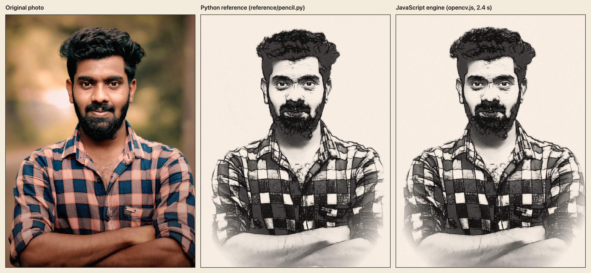
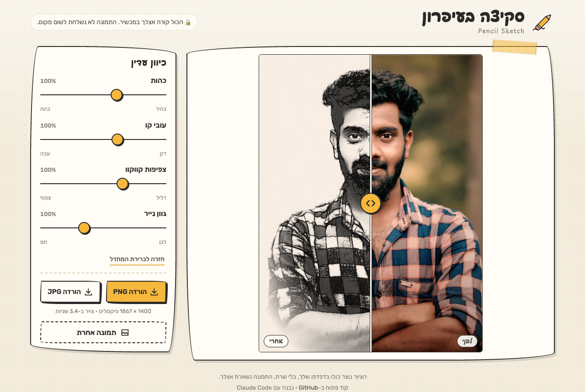
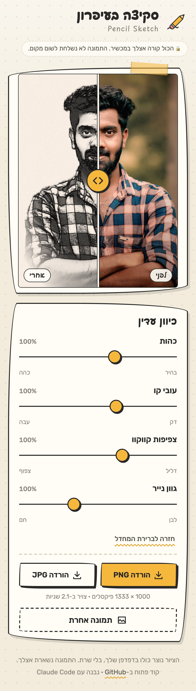

<div dir="rtl">

# סקיצה בעיפרון · Pencil Sketch

[English](README.md) · **עברית**

הופכים תמונה של אדם לסקיצה בעיפרון שנראית מצוירת ביד.
הכול רץ במכשיר שלכם. התמונה לא נשלחת לשום מקום.



## הורדה

| | קישור | הערות |
| --- | --- | --- |
| **בדפדפן** | **https://pencil-sketch-zeta.vercel.app** | בלי התקנה, עובד גם בטלפון |
| **מק** (macOS 12 ומעלה, Apple silicon ו-Intel) | [**PencilSketch-mac.dmg**](https://github.com/shmuelr16/pencil-sketch/releases/latest/download/PencilSketch-mac.dmg) | אפליקציה רגילה, עובדת בלי אינטרנט |
| **Windows** 10 / 11, התקנה | [**PencilSketch-Setup.exe**](https://github.com/shmuelr16/pencil-sketch/releases/latest/download/PencilSketch-Setup.exe) | אפליקציה רגילה, עובדת בלי אינטרנט |
| **Windows** 10 / 11, גרסה ניידת | [PencilSketch-windows-x64.zip](https://github.com/shmuelr16/pencil-sketch/releases/latest/download/PencilSketch-windows-x64.zip) | פותחים את ה-zip ומריצים |

כל הגרסאות: [Releases](https://github.com/shmuelr16/pencil-sketch/releases).

### התקנה במק

1. פותחים את `PencilSketch-mac.dmg` וגוררים את **Pencil Sketch** אל **Applications**.
2. האפליקציה לא עברה אישור (notarization) של Apple, ולכן הפתיחה הראשונה נחסמת. פותחים אותה פעם אחת, ואז נכנסים אל
   **הגדרות המערכת > פרטיות ואבטחה**, גוללים למטה ולוחצים **Open Anyway** (פתח בכל זאת).
   אפשרות אחרת, פעם אחת בטרמינל:

   <div dir="ltr">

   ```
   xattr -dr com.apple.quarantine "/Applications/Pencil Sketch.app"
   ```

   </div>
3. מכאן היא נפתחת כמו כל אפליקציה (Launchpad, Spotlight, Dock). אפשר לגרור תמונה על החלון או על האייקון ב-Dock.

### התקנה ב-Windows

1. מריצים את `PencilSketch-Setup.exe`. לא צריך הרשאות מנהל.
2. קובץ ההתקנה לא חתום, ולכן SmartScreen עשוי להציג "Windows protected your PC": לוחצים **More info** ואז **Run anyway**.
3. פותחים את **Pencil Sketch** מתפריט התחל. אפשר לגרור תמונה על החלון, או קליק ימני על תמונה > פתח באמצעות > Pencil Sketch.

דרוש Microsoft Edge WebView2 Runtime. הוא כבר חלק מ-Windows 11 ומ-Windows 10 מעודכן.

## איך זה נראה

| מחשב | טלפון |
| --- | --- |
|  |  |

- גוררים תמונה, בוחרים קובץ, או מצלמים בטלפון.
- פס הזזה של לפני/אחרי.
- ארבעה סליידרים: כהות, עובי קו, צפיפות קווקוו, גוון נייר (חם/לבן).
- שמירה כ-PNG או JPG.

## איך זה נבנה

**את כל הפרויקט הזה בנה לי [Claude Code](https://claude.com/claude-code), סוכן הקוד של Anthropic.**
אני נתתי לו מסמך דרישות וסקריפט פייתון אחד שכיוונתי ביד לתמונה אחת (`reference/pencil.py`).
Claude Code כתב את האלגוריתם מחדש ב-JavaScript, החליף את החלקים שכוונו ביד בזיהוי אוטומטי, ובנה את הממשק,
את האפליקציות למק ול-Windows, את תהליך הבנייה, את הבדיקות ואת התיעוד הזה.

### ספריות וכלים

| חלק | נבנה עם |
| --- | --- |
| מנוע הציור | [OpenCV.js](https://docs.opencv.org/4.9.0/d5/d10/tutorial_js_root.html) 4.9.0 (OpenCV מקומפל ל-WebAssembly), בתוך Web Worker |
| זיהוי עיניים | [MediaPipe Tasks Vision](https://ai.google.dev/edge/mediapipe/solutions/vision/face_landmarker) 0.10.14, ‏Face Landmarker |
| הפרדת האדם מהרקע | MediaPipe Image Segmenter, מודל selfie multiclass |
| ממשק | HTML, CSS ו-JavaScript רגילים (ES modules). בלי framework, בלי bundler, בלי שלב build |
| גופנים | Playpen Sans Hebrew, ‏Rubik (שמורים מקומית) |
| אפליקציית מק | Swift, AppKit, ‏`WKWebView` (בלי Electron), קומפילציה עם `swiftc` |
| אפליקציית Windows | ‏C#, ‏‎.NET 8, ‏WinForms, ‏[WebView2](https://developer.microsoft.com/microsoft-edge/webview2/) (בלי Electron), התקנה עם Inno Setup |
| אתר | קבצים סטטיים ב-Vercel |
| בנייה ושחרור גרסאות | GitHub Actions (מכונות macOS ו-Windows אמיתיות מריצות בדיקה עצמית בכל בנייה) |
| כלי פיתוח | Node.js, ‏playwright-core עם Chrome בלי ממשק |
| האלגוריתם המקורי | Python, OpenCV, NumPy ‏(`reference/pencil.py`) |

רישיונות של החלקים המצורפים: [`THIRD_PARTY_NOTICES.md`](THIRD_PARTY_NOTICES.md).

## איך המנוע עובד

אותו סגנון כמו בסקריפט הפייתון: משיכות קו לאורך הכיוון של הצורה (8 כיוונים), ארבע שכבות קווקוו בזוויות
45°/‎-45°/15°/80° שנדלקות ככל שהצל כהה יותר, גרפיט כהה לגבות, לשיער ולזקן, עיניים בגרפיט רך מהתמונה עצמה כדי
שייראו טבעיות, נייר בגוון חם עם גרעיניות, ודהייה בשוליים.

מה שכוון ביד לתמונה אחת נעשה עכשיו אוטומטית:

| סקריפט הפייתון (תמונה אחת) | הפרויקט הזה (כל תמונה) |
| --- | --- |
| מיקום עיניים קבוע בפיקסלים | MediaPipe Face Landmarker, עד 8 פנים. פנים קטנות מזוהות דרך חיתוכי תקריב. אין פנים: מדלגים על הטיפול בעיניים |
| GrabCut ואזורי רקע קבועים | הפרדת אדם מרקע עם MediaPipe. אין אדם: מציירים את כל התמונה |
| גדלים שכוונו לתמונה ברוחב 1400 פיקסלים | כל גודל מוכפל ב-`k` = קנה מידה של התמונה × קנה מידה של הפנים |
| כ-86 שניות | כ-2.5 שניות ל-1400 פיקסלים, עם פס התקדמות |

ברירת המחדל (כל הסליידרים על 100%) משחזרת את הפלט של הפייתון. התמונה `docs/compare.png` למעלה היא הבדיקה הזאת.
גודל העבודה: צד קצר של 1400 פיקסלים (1000 בטלפון). הקבצים נשמרים בגודל המלא הזה.

## מגבלות ידועות

- האפליקציות לא חתומות ולא עברו notarization (ראו הוראות ההתקנה למעלה).
- הפלט תמיד בצד קצר של 1400 פיקסלים, ולא בגודל של התמונה המקורית.
- פנים קטנות מאוד או מוסתרות עלולות להתפספס. הציור עדיין עובד, רק הטיפול המיוחד בעיניים מדולג.
- הכניסה הראשונה לאתר מורידה כ-40MB (מודלים ו-WebAssembly). האתר לא עובד בלי אינטרנט; האפליקציות כן.

## למפתחים

מבנה הריפו, הרצה מקומית, בדיקות ושחרור גרסה: ב-[README באנגלית](README.md#repository-layout).

## רישיון

[MIT](LICENSE). החלקים המצורפים מצד שלישי נשארים ברישיונות שלהם: [`THIRD_PARTY_NOTICES.md`](THIRD_PARTY_NOTICES.md).
תמונת הדוגמה: "Outdoors-man-portrait (cropped)", ‏Wikimedia Commons, ‏CC0.

</div>
