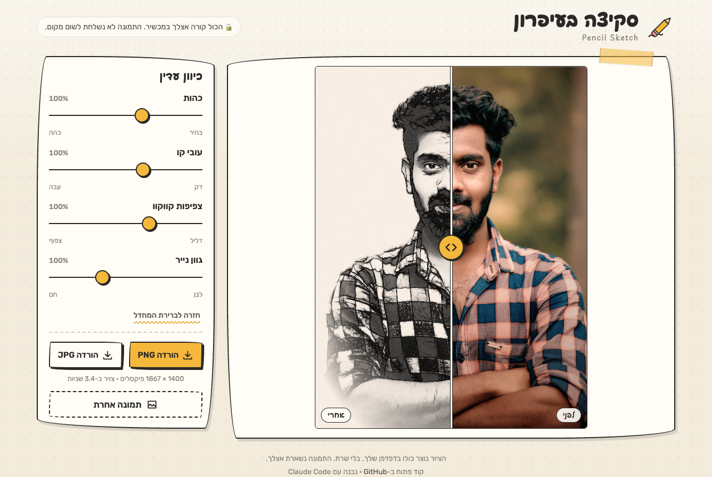
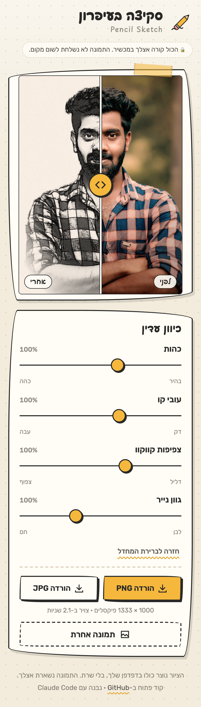

# Pencil Sketch · סקיצה בעיפרון

**English** · [עברית](README.he.md)

Turn a photo of a person into a pencil sketch that looks hand-drawn.
Everything runs on your own device. The photo is never uploaded anywhere.


## Get it

| | Download | Notes |
| --- | --- | --- |
| **In the browser** | **https://pencil-sketch-zeta.vercel.app** | nothing to install, works on phones too |
| **macOS** 12+ (Apple silicon and Intel) | [**PencilSketch-mac.dmg**](https://github.com/shmuelr16/pencil-sketch/releases/latest/download/PencilSketch-mac.dmg) | native app, works offline |
| **Windows** 10 / 11, installer | [**PencilSketch-Setup.exe**](https://github.com/shmuelr16/pencil-sketch/releases/latest/download/PencilSketch-Setup.exe) | native app, works offline |
| **Windows** 10 / 11, portable | [PencilSketch-windows-x64.zip](https://github.com/shmuelr16/pencil-sketch/releases/latest/download/PencilSketch-windows-x64.zip) | unzip and run |

All versions: [Releases](https://github.com/shmuelr16/pencil-sketch/releases).

### Install on macOS

1. Open `PencilSketch-mac.dmg` and drag **Pencil Sketch** onto **Applications**.
2. The app is not notarized by Apple, so the first launch is blocked. Open it once, then go to
   **System Settings > Privacy & Security**, scroll down and click **Open Anyway**.
   Or run this once in Terminal:
   ```
   xattr -dr com.apple.quarantine "/Applications/Pencil Sketch.app"
   ```
3. From then on it opens like any app (Launchpad, Spotlight, Dock). Drop a photo on the window or on the Dock icon.

### Install on Windows

1. Run `PencilSketch-Setup.exe`. No administrator rights needed.
2. The installer is not code-signed, so SmartScreen may say "Windows protected your PC": click **More info**, then **Run anyway**.
3. Start **Pencil Sketch** from the Start menu. Drop a photo on the window, or right-click a photo > Open with > Pencil Sketch.

Needs the Microsoft Edge WebView2 Runtime, which is already part of Windows 11 and of updated Windows 10.

## What it looks like

| Desktop | Phone |
| --- | --- |
|  |  |

- Drag a photo in, pick a file, or take a picture on a phone.
- Before/after slider.
- Four sliders: darkness, line thickness, hatch density, paper tone (warm/white).
- Save as PNG or JPG.
- The interface is in Hebrew (right to left).

## How this was built

**This whole project was built by [Claude Code](https://claude.com/claude-code), Anthropic's coding agent.**
The owner supplied a written brief and one Python script that had been tuned by hand for a single photo
(`reference/pencil.py`). Claude Code ported the algorithm to JavaScript, replaced the hand-tuned parts with automatic
detection, wrote the interface, the Mac and Windows apps, the build pipeline, the tests and these docs.

### Libraries and tools used

| Part | Built with |
| --- | --- |
| Drawing engine | [OpenCV.js](https://docs.opencv.org/4.9.0/d5/d10/tutorial_js_root.html) 4.9.0 (OpenCV compiled to WebAssembly), in a Web Worker |
| Finding eyes | [MediaPipe Tasks Vision](https://ai.google.dev/edge/mediapipe/solutions/vision/face_landmarker) 0.10.14, Face Landmarker |
| Separating the person from the background | MediaPipe Image Segmenter, selfie multiclass model |
| Interface | plain HTML, CSS and JavaScript (ES modules). No framework, no bundler, no build step |
| Fonts | Playpen Sans Hebrew, Rubik (stored locally) |
| Mac app | Swift, AppKit, `WKWebView` (no Electron), compiled with `swiftc` |
| Windows app | C#, .NET 8, WinForms, [WebView2](https://developer.microsoft.com/microsoft-edge/webview2/) (no Electron), installer by Inno Setup |
| Website | static files on Vercel |
| Builds and releases | GitHub Actions (real macOS and Windows machines run a self-test on every build) |
| Dev tools | Node.js, playwright-core with headless Chrome |
| Original algorithm | Python, OpenCV, NumPy (`reference/pencil.py`) |

Licenses of the bundled parts: [`THIRD_PARTY_NOTICES.md`](THIRD_PARTY_NOTICES.md).

## How the engine works

Same look as the Python script: outline strokes smeared along one of 8 directions, four hatching layers at
45°/-45°/15°/80° that switch on as the tone gets darker, dense graphite for brows, hair and beard, eyes rendered
softly from the real pixels so they stay natural, warm paper with grain, and edges that fade into the page.

What was hand-tuned for one photo is now automatic:

| Python script (one photo) | This project (any photo) |
| --- | --- |
| eye boxes at fixed pixels | MediaPipe Face Landmarker, up to 8 faces; small faces are found through close-up tiles. No face: the eye step is skipped |
| GrabCut + fixed "backdrop" zones | MediaPipe selfie segmentation. No person: the whole picture is drawn |
| sizes tuned for a 1400 px wide portrait | every size is multiplied by `k` = image scale × face scale |
| about 86 s | about 2.5 s for 1400 px, with a progress bar |

Defaults (all sliders at 100 %) reproduce the Python output; `docs/compare.png` above is that check.
Working size: short side 1400 px (1000 px on phones). Saved files have that full size.

## Repository layout

```
web/                  the whole app: UI + engine. Shared by the website, the Mac app and the Windows app
  index.html style.css
  js/app.js           page logic: picking a photo, before/after slider, sliders, saving
  js/pencil.js        pipeline API (decode -> detect -> worker). Used by app.js and by the tools
  js/detect.js        MediaPipe face landmarks + selfie segmentation (local model files)
  js/worker.js        Web Worker that owns opencv.js
  js/engine.js        the algorithm: a port of reference/pencil.py
  vendor/ models/     opencv.js, MediaPipe bundle + wasm, the two models
  fonts/ icons/ samples/ licenses/
mac/                  PencilSketch.swift, Info.plist, AppIcon.icns, build.sh, package.sh
windows/              PencilSketch/ (C# WinForms + WebView2), installer.iss
reference/pencil.py   the original hand-tuned Python script, kept as is
tools/                dev tools: serve, sketch, compare, shots, make-icons
.github/workflows/    build.yml: build + self-test both apps, release on a version tag
docs/                 compare.png and screenshots
```

## Develop

No build step. Any static server works:

```
npm install            # only for the dev tools (playwright-core)
npm run serve          # http://127.0.0.1:5173
```

Opening `web/index.html` straight from disk does not work (ES modules and workers need http).

```
node tools/sketch.mjs in.jpg out.png     # run the real engine headlessly on one image, prints timings
node tools/compare.mjs                   # Python vs JS -> docs/compare.png (needs python3 with opencv-python, numpy)
node tools/shots.mjs docs                # UI smoke test (desktop + phone) and screenshots
./mac/build.sh                           # build the Mac app (universal) and install it in /Applications
```

Self-test of an installed app (prints one line, exit code 0 = ok):

```
PENCIL_SELFTEST=1 "/Applications/Pencil Sketch.app/Contents/MacOS/PencilSketch"
selftest: OK 1400x1867 engine=3.6s total=6.4s faces=1 person=yes mean=180
```

Windows details: [`windows/README.md`](windows/README.md).

### Releasing

Push a version tag. GitHub Actions builds both apps, runs their self-tests and publishes the release:

```
git tag v1.0.1 && git push origin v1.0.1
```

## Known limits

- The apps are not code-signed or notarized (see the install notes above).
- Output is always 1400 px on the short side, not the size of the original photo.
- Very small or hidden faces can be missed; the sketch still works, only the special eye treatment is skipped.
- The first visit to the website downloads about 40 MB (models and WebAssembly). The website does not work offline; the apps do.

## License

[MIT](LICENSE). Bundled third-party parts keep their own licenses: [`THIRD_PARTY_NOTICES.md`](THIRD_PARTY_NOTICES.md).
Sample photo: "Outdoors-man-portrait (cropped)", Wikimedia Commons, CC0.
