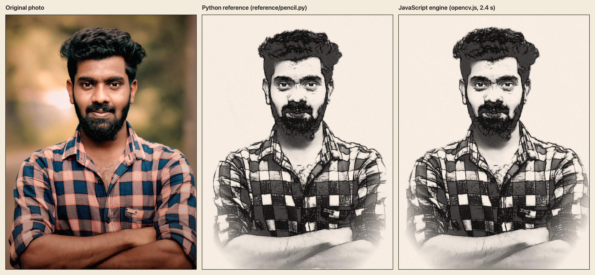

# סקיצה בעיפרון · Pencil Sketch

הופכים תמונה של אדם לציור עיפרון שנראה מצויר ביד.
הכול קורה אצלכם במחשב. התמונה לא נשלחת לשום מקום.

## הורדה

| | קישור להורדה ישירה |
| --- | --- |
| 🍎 **מק** | [**PencilSketch-mac.dmg**](https://github.com/shmuelr16/pencil-sketch/releases/latest/download/PencilSketch-mac.dmg) |
| 🪟 **Windows** | [**PencilSketch-Setup.exe**](https://github.com/shmuelr16/pencil-sketch/releases/latest/download/PencilSketch-Setup.exe) |
| 🌐 **בלי התקנה, בדפדפן** | [pencil-sketch-zeta.vercel.app](https://pencil-sketch-zeta.vercel.app) |

## התקנה במק

1. פותחים את הקובץ שירד וגוררים את **Pencil Sketch** אל **Applications**.
2. פותחים את האפליקציה. בפעם הראשונה המק יחסום אותה.
3. נכנסים אל **הגדרות המערכת ← פרטיות ואבטחה**, גוללים למטה ולוחצים **Open Anyway**.

זהו. מעכשיו היא נפתחת כמו כל אפליקציה.

## התקנה ב-Windows

1. מריצים את הקובץ שירד.
2. אם מופיע חלון כחול "Windows protected your PC": לוחצים **More info** ואז **Run anyway**.
3. פותחים את **Pencil Sketch** מתפריט התחל.

## איך משתמשים

גוררים תמונה לחלון, מחכים כמה שניות, ושומרים.
אפשר לשנות כהות, עובי קו, צפיפות קווקוו וגוון נייר.

## מי בנה את זה

את כל הכלי בנה **[Claude Code](https://claude.com/claude-code)**, סוכן הקוד של Anthropic.
גם הסקריפט הראשון הגיע מ-Claude: ביקשתי באפליקציית Claude בטלפון להפוך תמונה אחת שלי לציור עיפרון, והוא כתב סקריפט פייתון שכוון לתמונה הזאת.
את הסקריפט הזה נתתי ל-Claude Code עם הסבר מה אני רוצה, והוא בנה ממנו את כל השאר: המנוע, הממשק, האפליקציה למק, האפליקציה ל-Windows והאתר.

אני לא כתבתי כאן קוד. רק ביקשתי, בדקתי ואמרתי מה לשנות.

## זה לא כלי AI

הציור עצמו **לא** נוצר בבינה מלאכותית. אין כאן מחולל תמונות, ואין שרת.
זה אלגוריתם קבוע של עיבוד תמונה: הוא מוצא את קווי המתאר, מושך עליהם קווים, ומוסיף קווקוו במקומות הכהים.
לכן אותה תמונה נותנת תמיד אותו ציור, והפנים נשארות הפנים שלכם.

החלק היחיד שלומד מדוגמאות הוא מודל קטן שרץ אצלכם במחשב. הוא רק מסמן איפה הפנים ואיפה הרקע, ולא מצייר כלום.

## במה זה בנוי

- **OpenCV.js**: עיבוד התמונה והציור.
- **MediaPipe**: מציאת הפנים והרקע.
- **Swift + WKWebView**: האפליקציה למק.
- **C# + WebView2**: האפליקציה ל-Windows.
- **HTML, CSS, JavaScript**: הממשק, בלי שום framework.

## עוד

- פרטים טכניים למפתחים (באנגלית): [README.en.md](README.en.md)
- רישיון: [MIT](LICENSE). רכיבים של אחרים: [THIRD_PARTY_NOTICES.md](THIRD_PARTY_NOTICES.md)
- תמונת הדוגמה: Wikimedia Commons, ברישיון CC0.

